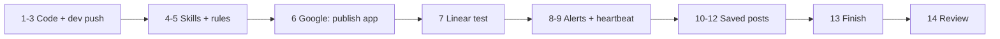

# Runbook: Linear fix, ops alerts, saved posts

Updated 2026-10-15. Everything here runs on **dev**. Production is the last,
optional step and stays your call.

**How to use this runbook.** Every step has the same four parts:

- **Do**: the commands or the message to send.
- **Expect**: what you should see.
- **If different**: what it means, and what to look at.
- **Continue?** ✅ means you can carry on and note it for your review. 🛑 means stop and send me what you saw.

Write down anything that didn't match, then send me one review at the end
using the template in step 14.



Already done by you, so skip: the Linear 401 fix (step 7 of the old
runbook) and the OpenAI key swap (step 7b of the old runbook).

---

## 1. Pull the new code

**Do**, from the repo root:

```bash
git status --short
# The plan doc below is untracked on your machine and is now part of the
# commit. Git refuses to overwrite an untracked file, so move yours aside.
mv docs/status-and-social-ingest-plan.md /tmp/
git pull --ff-only ./cleanup.bundle cleanup/assistant-behaviour
git log --oneline -4
```

**Expect:**

- The first `git status` lists only `?? cleanup.bundle` and `?? docs/status-and-social-ingest-plan.md`.
- The pull says `Fast-forward`.
- The log starts like this (the top line is the latest runbook edit):

```
xxxxxxx docs(runbook): … (this file; its id varies)
6ff02b1 feat(saved): read every post link in full, keep it, find it later, add to Notion lists
65c1626 feat(ops): Telegram alerts on failures, daily connection check, /health, heartbeat
87f6078 fix(linear): list every open issue across projects; verified bulk moves; no unbacked "done"
d118b84 fix(openai): always mention JSON in the input when json_object is on
```

**If different:**

- **`untracked working tree files would be overwritten`**: git lists the files. Move each one aside the same way and pull again. ✅
- **`Not possible to fast-forward`**: you have local commits on this branch. 🛑 Send me `git log --oneline -5`.
- **`M` lines in the first status**: these are uncommitted edits. Run `git stash`, pull, then run `git stash pop`. If `pop` reports a conflict, 🛑.

**Continue?** ✅ when the log matches.

## 2. Typecheck and test

**Do:**

```bash
bun install
bun run typecheck && bun test
```

**Expect:** `tsc --noEmit` prints nothing. Then `801 pass`, `1 todo`, `0 fail`.

**If different:**

- **Typecheck error in `convex/_generated/api.d.ts`**: run `bunx convex codegen` and then repeat this step. ✅
- **Any test failure**: 🛑 Send me the failing test names.

**Continue?** ✅ when it shows 0 fail.

## 3. Push to dev

**Do:** `bun run dev` and leave it running in its own terminal.

**Expect:**

- `Convex functions ready!`
- The first push adds the tables `savedItems`, `savedEntities`, `savedNudges` and `opsIncidents`, plus a vector index. That push can take a minute longer than usual.

**If different:**

- **Schema validation error**: 🛑 Send me the error.
- **`Index ... backfilling`**: wait for it to finish. ✅

**Continue?** ✅

## 4. Clear old skill copies (the old runbook's step 4)

Skills you edited in the database override the new defaults, so the new
voice never reaches those skills.

**Do:**

```bash
bunx convex run debug:skillOverrides '{}'
```

For every name that this command lists, run:

```bash
bunx convex run debug:resetSkill '{"name":"<name>"}'
```

**Expect:**

- `skillOverrides` prints a list of names, or `[]`.
- `resetSkill` prints the old text it removed.

**If different:**

- **`[]`**: there is nothing to reset. ✅
- **`unknown skill`**: copy the name exactly as `skillOverrides` printed it. ✅

**Continue?** ✅ Before you move on, copy any line from the old text you want to keep. You'll send it to the bot as an instruction in step 5.

## 5. Your saved formatting rules (the old runbook's step 5)

**Do:**

```bash
bunx convex run debug:rawInstructions '{}'
```

**Expect:** a numbered list of your standing rules.

**If different:** an empty list is fine. ✅

Then, in Telegram:

1. Send **"show my instructions"** to the bot.
2. Send **"remove instruction N"** for any rule that fights the new short voice, such as "always use headings" or "full report".

**Continue?** ✅

## 6. Google: stop the weekly disconnects

This is the actual fix for "reconnect my calendar over and over". While the
OAuth app is in **Testing**, Google expires refresh tokens after 7 days.
**In production** they don't expire.

**Do:**

1. Open [Google Cloud Console](https://console.cloud.google.com) → **Google Auth Platform** → **Audience**.
2. Click **Publish app** and confirm.
3. In **Data access**, check that Gmail (`gmail.modify`), Calendar and Drive (read-only) are listed.
4. In Telegram, run `/reconnect <label>` once for **every** mailbox. Tokens issued while the app was in Testing still die on their 7-day clock, so each mailbox needs a fresh one.
5. During each reconnect, Google shows **"Google hasn't verified this app"**. Click **Advanced** → **Go to … (unsafe)**. This is expected for a personal app. Verification is only needed above 100 users.

**Expect:**

- Publishing status reads **In production**.
- Each `/reconnect` ends with the bot saying the mailbox is connected.

**If different:**

- **No "Publish app" button, only "Back to testing"**: the app is already published. Do the reconnects anyway. ✅
- **Google demands verification before it will publish**: 🛑 Send me a screenshot.
- **A reconnect fails with an error page**: ✅ Continue, and note the label and the error.

**Continue?** ✅

## 7. Linear: the bug you reported

**Do**, in Telegram:

| Send | Expect |
|---|---|
| "how many tasks do I have?" | "8 tasks (showing 8):", grouped under **Migrants Shopping:** and **No project:**, including the 1 In Progress |
| "move the Migrants Shopping tasks to Done" | "📋 N tasks ready to move:" with the list, then **"Nothing has changed yet. Tap Apply…"** plus a card |
| Tap **Apply** on the card | "Applied N/N changes in Linear:" and "**Checked on the board: all N are where you asked.**" |
| Look at Linear | Those issues are in Done |

If you'd rather not close real work, use a filter that is safe for you,
such as "move THE-12 and THE-13 to Todo".

**If different:**

- **The count is lower than your board shows**: 🛑 Send me the bot's reply and the board count.
- **Any reply says "Done" or "moved" before you tapped Apply**: 🛑 That is the bug coming back.
- **"⚠️ Checked on the board: X of N did NOT move"**: the verification caught a real failure, which is the point of it. ✅ Note which issues it named.
- **`Couldn't do task.list — limit…`**: 🛑 The new code isn't running. Check that step 3 is still running.

**Continue?** ✅ when the counts match and nothing claims done before the tap.

## 8. Alerts reach you

**Do:**

```bash
bunx convex run debug:testAlert '{}'
bunx convex run debug:health '{}'
```

Then send `/health` to the bot.

**Expect:**

- **On Telegram**: "🔴 … failed: Test alert at …" with **Mute 24h** and **Health** buttons.
- **`debug:health`**: one row per connection, each `ok: true`. Rows for things you haven't set up yet (Apify, for example) show `skipped: true`.
- **`/health`**: ✅ rows, "▫️ … not set up" rows, and "No open failures." at the end.

**If different:**

- **No Telegram message**: 🛑 Run `bunx convex env get TELEGRAM_OWNER_ID`, check that it is your user id, and send me the result. Don't send the value of anything else.
- **The second `testAlert` within an hour sends nothing**: this is the dedupe working. ✅
- **A ⚠️ row for a Google mailbox**: that mailbox needs `/reconnect`. Redo step 6 for it. ✅
- **A ⚠️ row for Linear, Notion, OpenAI or Gemini**: ✅ Note the row's text.

**Continue?** ✅

## 9. Heartbeat: an alert when Convex itself is down

Telegram alerts can't fire if Convex stops running, so an outside service
watches for silence.

**Do:**

1. Create a free account on [healthchecks.io](https://healthchecks.io).
2. Add a check: **Period 10 minutes**, **Grace 20 minutes**. Copy its ping URL.
3. Set it in Convex:

```bash
bunx convex env set HEALTHCHECK_PING_URL '<the ping URL>'
```

**Expect:** within 10 minutes, the check turns green ("up") on healthchecks.io.

**If different:** if it stays "new" after 15 minutes, open the Convex dashboard → Logs and search for `heartbeat`. ✅ Note what you find.

**Continue?** ✅ This step is optional: everything else works without it.

## 10. Saved posts: keys and lists

**Do:**

1. **Apify**, which reads every slide of an Instagram carousel (free plan, $5 of credit a month):
   - Get a token at [console.apify.com](https://console.apify.com) → Settings → API & Integrations.
   - Run `bunx convex env set APIFY_TOKEN '<token>'`.
2. **Notion Movies list**:
   - Create a database called **Movies** with these columns:
     - **Name** (title)
     - **Status** (status, with the options *To watch* and *Watched*)
     - **Source** (URL)
     - **Detail** (text)
   - Open **••• → Connections** and add your PA integration.
   - Copy the database id. It is the 32 characters before `?v=` in the page URL.
3. Optionally, create a **Tools** database with the same columns, using *To try* and *Done* as the status options.
4. Set the mapping. Use single quotes around the JSON:

```bash
bunx convex env set NOTION_LISTS '{"movies":"<movies db id>","tools":"<tools db id>"}'
bunx convex run debug:health '{}'
```

**Expect:** `debug:health` now shows Apify `ok: true`.

**If different:**

- **Apify says `401`**: the token is wrong. Copy it again. ✅
- You can skip Apify entirely. Without it, Instagram gives the caption and the first slide only, and the bot says so. ✅

**Continue?** ✅

## 11. Saved posts: try it

**Do**, in Telegram:

| Send | Expect |
|---|---|
| An X/Twitter post link | 🔗 title, a one-line summary, "In it (N)" if it names things, then "📌 Saved. Ask me about it any time." |
| An Instagram carousel link with a list of films | "Read N slides." and every film numbered under "In it" |
| The same link again | "📌 Already saved", and it comes back instantly with no re-read |
| "add these to my movies list" (right after) | "📥 Found N items" and a card listing **all N**, with "Add all N" |
| Tap **Add all N** | "✅ Added N to your movies list in Notion." The rows appear in Notion with Status *To watch* |
| "I'm bored, which movie should I watch?" | One or two picks **from your Movies list**, with a reason |
| "I watched <one of them>" | "✅ Marked <name> as Watched on your movies list." |
| "what was that open source tool I saved for <topic>?" | It names the tool and the post it came from. Save a post about one first. |
| "forget that post" (after a search) | "🗑️ I'll stop bringing up …" |

**If different:**

- **"Not all of this post could be read"** on an Instagram carousel: this is expected without Apify. With Apify set, ✅ note the link.
- **The bot lists fewer films than the slides show**: ✅ Note the link and both counts.
- **"no list called movies"**: 🛑 Check the `NOTION_LISTS` JSON.
- **The Notion add fails with "Could not find database"**: the integration isn't connected to that database. Redo step 10.2. ✅
- **The bot recommends a film that isn't on your list**: ✅ Note the reply.
- **Any reply is a raw error**: ✅ You should also get a 🔴 alert. Note both.

**Continue?** ✅

## 12. Saved posts: the background jobs

There is nothing to run here. Check these over the next few days:

- **When you move a Linear issue to In Progress**, you may get "💡 You just started …. You saved …" with **Show it / 👍 / 👎 Not now** buttons. This happens at most once a day, and only when a saved post clearly helps, so silence is normal.
- **Saturday 10:00**: "🍿 Weekend pick: …" from your Movies list. Set `WEEKEND_PICK=off` to stop it.
- **Daily 06:30**: a connection check. You only hear from it when something is broken.
- **19:00**: a digest, only if something failed 3 or more times that day.

**If different:** a nudge that isn't relevant is fine. Tap 👎 and it gets pickier. ✅

## 13. Finish

**Do:**

1. Delete `cleanup.bundle` and `.cleanup-transfer.tgz`, if it exists, from the repo folder.
2. When you're happy, merge:

```bash
git checkout main && git merge --ff-only cleanup/assistant-behaviour
```

3. **Production is your call.** Before you run `bunx convex deploy`, set the same environment variables on prod with `bunx convex env set --prod …`:
   - `HEALTHCHECK_PING_URL`. Use a second healthchecks.io check, not the dev one.
   - `APIFY_TOKEN`
   - `NOTION_LISTS`
   - the OpenAI variables
4. After the deploy, run `/reconnect` for each mailbox on the prod bot, then send `/health`.

**Expect:**

- The merge says `Fast-forward`.
- On prod, `/health` shows all ✅.

**If different:** if the merge says `Not possible to fast-forward`, `main` has moved. 🛑

## 14. Send me one review

Copy this, fill it in, and paste it in the thread:

```
Steps done: 1-13 (or where I stopped: __)
Stopped at a 🛑? step __, what I saw: __
Didn't match but continued (step: what happened):
- 
Linear: board count __, bot count __, Apply verified? y/n
Saved posts: links that read badly: __
Anything else odd:
```
