# Runbook: go to production

Written 2026-10-16. This runbook takes you from your branch to a running
production bot, in this order:

1. Merge the branch into `main`.
2. Move Google Cloud to production.
3. Set the production environment.
4. Deploy to Convex prod.
5. Connect your accounts.

It stands alone: you don't need `RUNBOOK-cleanup.md` open alongside it.

Every step has the same four parts:

- **Do**: what to run or click.
- **Expect**: what you should see.
- **If different**: what that means and what to check.
- **Continue?** ✅ means safe to go on (note it for your review). 🛑 means stop and send me what you saw.

```mermaid
flowchart LR
  T[0 Test on dev] --> M[1 Merge to main]
  M --> G[2 Google to production]
  G --> K[3 Keys and secrets]
  K --> E[4 Prod env]
  E --> D[5 Deploy]
  D --> V[6 Verify]
  V --> W[7 Webhook]
  W --> A[8 Connect accounts]
  A --> S[9 Smoke test]
  S --> C[10 Dev clean-up]
  C --> R[11 Review]
```



What I checked before writing this (names and same/different only, never
values): your branch matches mine, `main` is still at `18aea73` so it will
fast-forward, and `.env.dev` / `.env.prod` already separate everything the
Day 0 guide says must differ.

| | dev | prod |
|---|---|---|
| Convex deployment | `coordinated-owl-164` | `wonderful-fish-292` |
| Telegram bot | dev bot | prod bot |
| OAuth redirect | `https://coordinated-owl-164.convex.site/oauth/google/callback` | `https://wonderful-fish-292.convex.site/oauth/google/callback` |
| Pub/Sub topic | `gmail-push-dev` | `gmail-push-prod` |
| Pub/Sub audience | `coordinated-owl-164.convex.site` | `wonderful-fish-292.convex.site` |

---

## 0. Pull the latest fixes and test them on dev

These fixes come from your own testing: every slide is read, reels are
watched, a new link is treated as a new topic, and the reply is a summary
rather than a dump.

**Do:**

```bash
git switch cleanup/assistant-behaviour
git pull --ff-only ./cleanup.bundle cleanup/assistant-behaviour
bun run typecheck && bun test
bun run dev            # leave running; pushes to dev
```

Then put every AI task on free Gemini models (added 2026-10-16).
`gemini-3.7-flash` is retired and Google now redirects it to `gemini-3.8-flash`.
The `gemini-flash-latest` alias floats to the newest model, so it can land on
a paid one too. These ladders name only models that served on your free key:

```bash
bunx convex env set GEMINI_MODEL_REASON           "gemini-3.5-flash,gemini-3.6-flash,gemini-3-flash-preview"
bunx convex env set GEMINI_MODEL_DRAFT            "gemini-3.5-flash,gemini-3.6-flash,gemini-3-flash-preview"
bunx convex env set GEMINI_MODEL_VISION           "gemini-3.5-flash,gemini-3.6-flash,gemini-3-flash-preview"
bunx convex env set GEMINI_MODEL_TRANSCRIBE       "gemini-3.5-flash,gemini-3.6-flash,gemini-3-flash-preview"
bunx convex env set GEMINI_MODEL_CHEAP_STRUCTURED "gemini-3.5-flash-lite,gemini-3.1-flash-lite"
bunx convex run debug:aiRoutes '{}'
```

Copy the same five lines into `.env.dev` and `.env.prod`, replacing the old
`GEMINI_MODEL_*` lines, so a later `--from-file` doesn't bring 3.7 back.

**Expect:** `aiRoutes` prints one line per task and `"warnings": []`. Each line
reads `TASK (TIER): provider[models] → fallback[models]`. `TRANSCRIBE_VOICE`
and `TRANSCRIBE_VIDEO` list only `gemini`, and `EMBED_TEXT` lists only
`gemini[gemini-embedding-001]`.

**If different:**
- **A warning names an `OPENAI_MODEL_*` or `GEMINI_MODEL_*` variable**: set that variable again without the named model. ✅
- **A task says `NO PROVIDER`**: its tier has no ladder on any provider. Set the `GEMINI_MODEL_<TIER>` it names. ✅
- **An `openai[...]` model isn't in OpenAI's free-token list** ([the list](https://help.openai.com/en/articles/10306912-sharing-api-traffic-with-openai)): every call to it is billed. Change it to a listed name, or 🛑 and send me the `aiRoutes` output.

Then send these to the **dev** bot:

1. **The household-hacks carousel link.**
   - **Expect:** one line on what it is, then all of the hacks numbered (6 to 8, not 1), each said the way the post means it (e.g. "Centipedes: sprinkle salt around the house"). No "follow us" item. A last line offers to save it or add it to a list.
2. **"forget that post"**
   - **Expect:** "🗑️ I'll stop bringing up …" with that post's title.
3. **The 10-things video link.**
   - **Expect:** all 10 points, or one plain line saying why it couldn't watch the video (too long, too big, or no APIFY_TOKEN), plus what it got from the caption.
4. **An unrelated link right after it.**
   - **Expect:** an answer about the new post only.

**Expect:** the pull says `Fast-forward`. Typecheck is clean and the tests show `824 pass, 0 fail`.

**If different:**
- **Still one item from the carousel, with "Not all of this post could be read"**: Instagram served the cover only.
  1. Get a token at [console.apify.com](https://console.apify.com) → Settings → API & Integrations (free plan).
  2. Run `bunx convex env set APIFY_TOKEN '<token>'`.
  3. Resend the link. It gets read again. ✅
- **Still one item, and no such line**: 🛑 Send me the link and the reply.
- **The video says "without APIFY_TOKEN I can only read the caption"**: set the token as above and resend the link. ✅
- **Any answer about the old post**: 🛑

**Continue?** ✅ when the carousel comes back complete.

## 1. Merge into main

`cleanup.bundle` is only how my commits reach your computer. Once you've
pulled from it, delete it. `*.bundle` is in `.gitignore`, so it won't show up
in `git status`.

**Do:**

```bash
git switch main
git merge --ff-only cleanup/assistant-behaviour
git log --oneline -1          # same commit as the branch
git status --short            # expect nothing
rm cleanup.bundle
```

**Expect:** `Fast-forward`, then a clean tree.

**If different:**
- **`Not possible to fast-forward`**: run `git merge cleanup/assistant-behaviour` (an ordinary merge commit). If it reports conflicts, run `git merge --abort` and 🛑.
- **`untracked working tree files would be overwritten`**: move the named files aside with `mv <file> /tmp/`, then retry. ✅

Keep the branch; it's what you'd roll back to.

**Continue?** ✅ when `main` matches the branch.

## 2. Google Cloud: move the app to production

Your Day 0 guide (§1.2 B2) says to keep the consent screen in **Testing**.
**This step deliberately changes that.** Testing mode is the reason every
mailbox and calendar disconnects after 7 days. Publishing changes only two
things:

- tokens stop expiring;
- anyone could sign in (your code still only serves `TELEGRAM_OWNER_ID`).

There is one consent screen and one OAuth client for both deployments, so
this covers dev and prod together.

**Do**, in [Google Cloud Console](https://console.cloud.google.com), in your PA project:

1. **Google Auth Platform → Branding.** Check that the app name, user support email and developer contact email are filled in. A homepage and privacy policy are only needed for verification, which you don't need.
2. **Google Auth Platform → Data access.** Check the scopes:
   - `gmail.readonly`, `gmail.compose`, `gmail.send`, `gmail.modify`
   - `calendar.readonly`, `calendar.events`
   - `drive.readonly`
   - Never `https://mail.google.com/`.
3. **Google Auth Platform → Clients → your web client.** Both redirect URIs from the table above should be listed.
4. **Pub/Sub → Subscriptions → the subscription on `gmail-push-prod`.** Check:
   - push endpoint is `https://wonderful-fish-292.convex.site/webhooks/gmail`;
   - authentication is **on**;
   - the audience is the prod value.
5. **Google Auth Platform → Audience → Publish app**, and confirm.

**Expect:**
- Items 1 to 4 already match. Day 0 set them up.
- Publishing status reads **In production**. A "needs verification" notice is normal for a personal app.
- **Leave verification unsubmitted.** The PA is yours alone. An unverified app in production keeps working: sign-in shows a "Google hasn't verified this app" screen (step 8), and Google caps it at 100 users, which doesn't matter for one owner. Submit for verification only if other people will ever sign in.

**If different:**
- **A redirect URI is missing**: add it and save. ✅
- **The prod subscription is missing, or its endpoint or audience is wrong**: fix the endpoint or audience and save. ✅ If the subscription doesn't exist at all, 🛑 (it needs the service-account chain from the guide's §1.2 B4).
- **Google refuses to publish until the app is verified**: 🛑 Send a screenshot.

**Continue?** ✅

Tokens issued while the app was in Testing still expire on their old 7-day
clock. You'll connect prod mailboxes fresh in step 8, which fixes that for
prod. Run `/reconnect` on dev once for each dev mailbox.

## 3. Keys and secrets: which must differ

The rule: anything that **proves who you are to your own system** must be
different per environment. API keys for **outside services** can be shared;
separate keys only buy you the ability to revoke one without breaking the
other.

### Must differ (yours already do; leave them)

| Variable | Why | How to rotate if you ever need to |
|---|---|---|
| `ENCRYPTION_KEY` | Seals every stored token (mailboxes, Linear). The same key on both would let a dev bug read prod secrets. | **No in-place rotation.** A new key orphans every connected account. To rotate: `openssl rand -base64 32`, `bunx convex env set --prod ENCRYPTION_KEY '<new>'`, then `/reconnect` every mailbox and rerun `debug:connectLinear`. Keep both keys in your password manager. **Prod has no accounts yet, so rotating it now costs nothing.** |
| `TELEGRAM_BOT_TOKEN` | One bot per deployment; a bot has exactly one webhook. | In BotFather: `/revoke`, pick the prod bot, copy the new token. Then `bunx convex env set --prod TELEGRAM_BOT_TOKEN '<new>'`, update `.env.prod`, and rerun step 7. |
| `TELEGRAM_WEBHOOK_SECRET` | Telegram sends it with every update, and the bot rejects any request without it. Shared, a dev leak would let someone post fake prod messages. | `openssl rand -hex 32`, then `bunx convex env set --prod …`, update `.env.prod`, and rerun step 7. The register script sends the new secret to Telegram. |
| `GOOGLE_REDIRECT_URI` | Each deployment has its own domain. | Not a secret; nothing to rotate. |
| `GOOGLE_PUBSUB_TOPIC` / `GOOGLE_PUBSUB_AUDIENCE` | With one topic, dev would process prod mail. | Not secrets. |
| `HEALTHCHECK_PING_URL` | **New.** One check per deployment, so "prod is down" isn't hidden by dev pings. | Create a second check on healthchecks.io. |

### Recommended to differ (your call)

| Variable | Today | Why separate | How |
|---|---|---|---|
| `LINEAR_API_KEY` | same on both | A Linear personal key can do everything you can. With separate keys you can revoke the dev one without breaking prod. | Linear → Settings → Security & access → new personal key named "PA prod". Then `bunx convex env set --prod LINEAR_API_KEY '…'` and `bunx convex run --prod debug:connectLinear '{}'` (after step 8). |
| `NOTION_API_KEY` (+ `NOTION_NOTES_DATABASE_ID`, `NOTION_LISTS`) | same on both | Dev tests write to your real notes and lists. A "PA dev" integration shared only with test databases keeps your real Movies list clean. | Notion → Settings → Connections → Develop integrations → new integration. Share it with test copies of the databases and put that key and those ids on **dev**. |

### Fine to share

- `GEMINI_API_KEY`, `OPENAI_API_KEY`, `OPENROUTER_API_KEY`: the free quota is per account or project anyway.
- `APIFY_TOKEN`: one $5 monthly credit.
- `GOOGLE_CLIENT_ID` / `GOOGLE_CLIENT_SECRET`: one client by design.
- `GOOGLE_PUBSUB_SA_EMAIL`, `ZOHO_*`, `TELEGRAM_OWNER_ID`: `TELEGRAM_OWNER_ID` is you, not a bot.

**Rotate anything** that was ever pasted into a chat, an issue or a
screenshot, or committed. The pre-commit gitleaks hook guards commits; chats
it can't guard.

**Continue?** ✅ once you've decided on Linear and Notion. Keeping them the same is a valid choice.

## 4. Copy the environment to prod

Dev's deployment holds the current settings: OpenAI, routes, Notion, Linear
team, the free Gemini ladders, the ops and saved-posts variables. Prod still
has the Day 0 set. `scripts/sync-env.ts` rebuilds both local files from the
deployments and prints names only, never values:

- `.env.dev` = exactly what the dev deployment has.
- `.env.prod` = everything from dev, except the seven that must be prod's own (`ENCRYPTION_KEY`, `TELEGRAM_BOT_TOKEN`, `TELEGRAM_WEBHOOK_SECRET`, `GOOGLE_REDIRECT_URI`, `GOOGLE_PUBSUB_TOPIC`, `GOOGLE_PUBSUB_AUDIENCE`, `HEALTHCHECK_PING_URL`). Those come from the prod deployment, or the old `.env.prod` if the deployment lacks one.
- It stops if any of those seven is missing, equals dev, or a value anywhere still points at `coordinated-owl-164` or `gmail-push-dev`.
- The old files are kept as `.env.dev.bak` and `.env.prod.bak`.

**Do:**

```bash
bun scripts/sync-env.ts
bunx convex env set --prod --force --from-file .env.prod
bunx convex run --prod debug:aiRoutes '{}'
```

**Expect:**
- The script ends with `✓ Ready`, and the kept list names the seven.
- The `env set` prints the variables it changed.
- `aiRoutes` on prod matches dev's: `openai[...]` where dev has it, Gemini models `gemini-3.5-flash,...`, and `"warnings": []`.

**If different:**
- **`✗ Fix before pushing to prod`, `HEALTHCHECK_PING_URL: no prod value`**: make a second check at healthchecks.io, then run `bunx convex env set --prod HEALTHCHECK_PING_URL '<url>'` and rerun the script. ✅
- **`... prod value is the same as dev`**: that secret was copied at some point. Rotate it (step 3), then rerun. ✅
- **`... value points at dev`**: set the prod value for that name with `bunx convex env set --prod NAME '<value>'`, then rerun. ✅
- **`bunx convex env list --prod failed`**: run `bunx convex login` and retry. ✅
- **Prod has a variable you deliberately made different (for example its own `LINEAR_API_KEY`)**: the script copied dev's over it in `.env.prod`. Edit that line in `.env.prod` before the `env set`. ✅

**Continue?** ✅ when prod's `aiRoutes` matches dev's.

## 5. Deploy

**Do:**

```bash
git branch --show-current     # must print: main
git status --short            # must be empty
bun run typecheck && bun test
bunx convex deploy
```

**Expect:**
- The deploy names `wonderful-fish-292` and asks you to confirm.
- Then: `Deployed Convex functions to https://wonderful-fish-292.convex.cloud`.

**If different:**
- **A schema validation error**: old prod rows don't fit the new schema. Prod keeps running its old code, so nothing broke. 🛑 Send the error.
- **It names `coordinated-owl-164`**: that's dev. Stop and 🛑.

**Continue?** ✅

## 6. Verify from the command line first

**Do:**

```bash
curl -s https://wonderful-fish-292.convex.site/health
bunx convex run --prod debug:pingAI '{"task":"PLAN_TOOLS"}'
bunx convex run --prod debug:cryptoSelfTest '{}'
```

**Expect:**
- `{"status":"ok","configOk":true}`
- `pingAI` names the same provider and model as dev's `aiRoutes` line for `PLAN_TOOLS`.
- The crypto self-test passes.

Then run `bunx convex run --prod debug:aiRoutes '{}'`. **Expect:** the same lines as on dev, and `"warnings": []`.

**If different:**
- **`configOk: false`**: a required variable is missing. Rerun step 4's script. 🛑 if it says `✓ Ready` and this still fails.
- **`pingAI` fails**: an AI variable didn't copy. Fix it in step 4. ✅

**Continue?** ✅

## 7. Point the prod bot at prod

**Do:**

```bash
./scripts/register-telegram-webhook.sh prod
./scripts/register-telegram-webhook.sh prod --info
```

**Expect:**
- `url` is `https://wonderful-fish-292.convex.site/webhooks/telegram`
- `pending_update_count` is `0`
- `last_error_message` is `null`

**If different:**
- **`could not determine the .convex.site URL`**: run `bunx convex env set --prod CONVEX_SITE_URL https://wonderful-fish-292.convex.site`, then retry. ✅
- **A `last_error_message` appears after you message the bot**: 🛑

## 8. Connect your accounts on prod

The prod database starts **empty**. These things on dev don't carry over:

- mailboxes and Linear;
- your saved facts and standing rules;
- saved posts.

**Do:**

1. Send `hi` to the **prod** bot. This creates your user.
2. `/connect <label>` for each real mailbox, using the same labels as on dev, then send `/accounts`.
3. Connect Linear:

   ```bash
   bunx convex run --prod debug:connectLinear '{}'
   ```

4. Check health and alerts:

   ```bash
   bunx convex run --prod debug:health '{}'
   bunx convex run --prod debug:testAlert '{}'
   ```

5. Tell the bot again anything it should know about you, such as "remember I prefer short replies".

**Expect:**
- `/accounts` lists each mailbox as ACTIVE.
- `connectLinear` prints your team keys.
- `debug:health` shows all `ok: true`, or `skipped: true` for anything not set up.
- A 🔴 test alert arrives **from the prod bot**.

**If different:**
- **Google shows `redirect_uri_mismatch`**: redo step 2, item 3. ✅
- **`owner has no user row`**: do item 1 first. ✅
- **No test alert arrives**: check prod's `TELEGRAM_OWNER_ID`. 🛑
- **"Google hasn't verified this app"**: choose Advanced → Go to … This is expected. ✅

## 9. Smoke test on the prod bot

**Do:**

1. Send "how many tasks do I have?"
2. Send the household-hacks link.
3. Send "which movie should I watch?"
4. Run `/health`.
5. Watch the logs for ten minutes:

   ```bash
   bunx convex logs --prod
   ```

**Expect:**
- The same answers you got on dev.
- No red errors in the logs.
- The prod healthchecks.io check turns green within 10 minutes.

**If different:** a wrong answer is ✅ (note it). A silent bot is 🛑.

## 10. Stop dev from doubling up on your real mail

If your real mailboxes are also connected on **dev**, both bots will alert
on the same email, and the two daily Gmail watch renewals can override each
other.

**Do:**

1. Open the Convex dashboard → **dev** deployment → Data → `connectedAccounts`.
2. Set `status` to `REVOKED` on each **real** mailbox row.

**Expect:** the dev bot stops alerting on real mail. This is reversible: `/reconnect` on dev restores it. ✅

## Rollback

There's no `convex rollback`; you redeploy an older commit:

```bash
git log --oneline -10
git checkout <last-good-sha> && bunx convex deploy && git checkout main
```

- **A failed deploy changes nothing.** The old code keeps running.
- **A bad AI provider can be dropped without deploying:** `bunx convex env set --prod AI_PROVIDER_PRIORITY gemini`.

## 11. Send me one review

```
Got to step: __ (all? y/n)
Stopped at a 🛑? step __, what I saw: __
Didn't match but continued (step: what happened):
- 
Carousel test: items found __ of __
Video test: points found __ of __, or the reason it gave: __
Keys: separate Linear? y/n  separate Notion for dev? y/n
```
