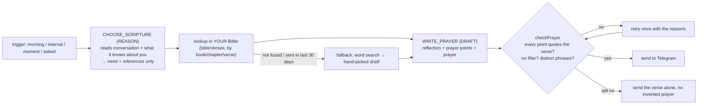

# Scripture — verses and prayer through the day

The assistant sends you Bible verses that fit what is going on, each with a
short reflection, prayer points drawn from the verse, and a closing prayer.
The verse text always comes from a Bible **you imported**, never from the
model's memory.

## What you get

| When | What | Need |
|---|---|---|
| 06:30 every morning (or with the morning brief, whichever is first) | A brief, grateful verse — mostly Psalms — tied to what today holds | thanksgiving |
| Every ~2½ hours, 10:00–21:30 | A verse about whatever is going on in your conversations and context | chosen |
| ~45 s after you say something heavy or big | A verse for that moment ("I'm so stressed", "applying for a job", "I want to give up", "I'm tempted to…", "I got the job!") | detected |
| `/verse`, `/verse calm`, `/verse job interview at 3`, or "give me a verse" | One now | yours or chosen |

The needs are the ones you asked for: **affirmation** (who God says you
are), **walk** (keeping your walk with God right), **faith**,
**perseverance** (keep going), **joy** (a smile), **check** (keep me in
check), **peace** (calm down), **work** (jobs, interviews, provision),
**guidance**, and **thanksgiving**.

Limits: 8 verses a day at most, 4 of them "moment" verses, 45 minutes
between moments. A daytime verse waits while you are mid-conversation, and
never lands within 20 minutes of a personality check-in.

### Example (morning)

```
🌅 Good morning, Adedotun.

Psalm 118:24 (KJV)
> This is the day which the LORD hath made; we will rejoice and be glad in it.

The psalmist calls a day God made a reason to rejoice — including the one
with the Paystack application in it.

Pray it:
- "the day which the LORD hath made" — Thank You that today is Yours before
  it is mine…
- "we will rejoice and be glad in it" — …

🙏 Father, … In Jesus' name, Amen.
```

## How a verse is chosen and prayed (the two systems)



1. **The chooser** (`convex/lib/scripture/devotional.ts`, `CHOOSE_SYSTEM`)
   is shown your recent conversation, the running summary, what you have
   told the assistant about yourself, the 10 needs, and a hand-picked shelf
   of ~145 passages (`convex/lib/scripture/needs.ts`, each read against the
   KJV). It returns a need and up to five **references**. It never writes
   verse text.
2. **Code looks the reference up** in your imported Bible. A reference that
   does not exist there, or overlaps a verse sent in the last 30 days, is
   skipped.
3. **The prayer writer** (`PRAYER_SYSTEM`) gets the passage exactly as
   printed and your situation, and must tie every prayer point to an
   `anchor` — words copied from the passage. It is told not to promise
   what the verse does not promise (a verse about committing your work to
   God does not guarantee the job).
4. **`checkPrayer` verifies it**: each anchor must actually appear in the
   passage (80% of its words, in order), anchors must differ, and points
   must say something ("bless me" alone is rejected). One retry with the
   reasons; if it still fails, the verse goes out alone.

## Getting a Bible in

### Which format to download

Any of these work; the format is detected from the content
(`convex/lib/scripture/parse.ts`):

| Source | Format | Good for |
|---|---|---|
| **Bible SuperSearch** export (what you uploaded: `{ metadata, verses: [{ book, chapter, verse, text }] }`) | JSON | already imported: `assets/bibles/KJV.json` |
| [scrollmapper/bible_databases](https://github.com/scrollmapper/bible_databases) → `formats/json/KJV.json`, `BSB.json`, `ASV.json`, `YLT.json` | JSON | public-domain translations, one file each |
| [Beblia/Holy-Bible-XML-Format](https://github.com/Beblia/Holy-Bible-XML-Format) → `EnglishKJBible.xml`, `EnglishNIVBible.xml`, … | XML | the widest choice of translations (incl. modern ones) |
| [thiagobodruk/bible](https://github.com/thiagobodruk/bible) → `json/en_kjv.json`, `en_bbe.json` | JSON | simple, small |
| Zefania XML, OSIS XML, or a CSV with `book,chapter,verse,text` columns | XML / CSV | anything else you find |

Name the file after its code (`NIV.xml`, `BSB.json`) and that becomes the
translation code, unless the file names its own (SuperSearch does).

Note: scrollmapper and SuperSearch print a psalm's title ("A Psalm of
David.") at the start of verse 1. That is in the source data, not a bug;
Beblia's files leave it out.

### ⚠ Copyright — this repository is public

- **Public domain, safe to commit to `assets/bibles/`:** KJV, ASV, YLT,
  Darby, Webster, WEB, BSB (Berean Standard Bible, public domain since 2023).
- **Copyrighted — do NOT commit here:** NIV, ESV, NKJV, NLT, AMP, NASB, CSB,
  MSG. Committing them to a public repo is redistributing them. Put those
  files in `assets/bibles/private/` (gitignored) on your own machine and
  import them from there. Reading them in your own private database for
  personal devotion is the same use as a Bible app; publishing the file is
  not.

### Importing

```bash
bun scripts/import-bible.ts assets/bibles/KJV.json --check   # parse + verify, writes nothing
bun scripts/import-bible.ts assets/bibles/KJV.json           # into dev
bun scripts/import-bible.ts assets/bibles/KJV.json --prod    # into production
bun scripts/import-bible.ts --all                            # every file in assets/bibles/
bun scripts/import-bible.ts assets/bibles/private/NIV.xml    # a copyrighted one, local only
bun scripts/import-bible.ts assets/bibles/KJV.json --replace # re-import
```

The script parses the file, checks every shelf verse exists in it, writes
the verses with one `convex import --append`, then registers the
translation. About 10 seconds per Bible.

Then in Telegram:

```
/scripture          settings + imported Bibles
/scripture NIV      read from NIV from now on
/scripture morning 06:15
/scripture every 3h
/scripture off      no unprompted verses (/verse still works)
/verse              one now
```

## Cost

Two model calls per verse (one REASON, one DRAFT), about 8 a day at most —
well inside the free tiers. Storage is ~5–7 MB per translation of the
Convex free 0.5 GB. No embeddings: verses are found by reference, then by
Convex full-text search.

## Files

| File | What |
|---|---|
| `convex/lib/scripture/books.ts` | the 66 books and every spelling files use |
| `convex/lib/scripture/reference.ts` | "Phil 4:6-7" ⇄ a typed passage |
| `convex/lib/scripture/parse.ts` | Bible file → verses, every format above |
| `convex/lib/scripture/needs.ts` | the 10 needs and the hand-picked shelf |
| `convex/lib/scripture/moment.ts` | "does this message need a verse?" |
| `convex/lib/scripture/schedule.ts` | when verses go out; settings |
| `convex/lib/scripture/devotional.ts` | both prompts, parsing, `checkPrayer`, rendering |
| `convex/model/scripture.ts` | `bibleTranslations`, `bibleVerses`, `scriptureSends` |
| `convex/scripture.ts` | the cron tick, moments, `/verse`, the pipeline |
| `scripts/import-bible.ts` | the importer |
| `tests/unit/scripture.test.ts` | all of the pure parts |
