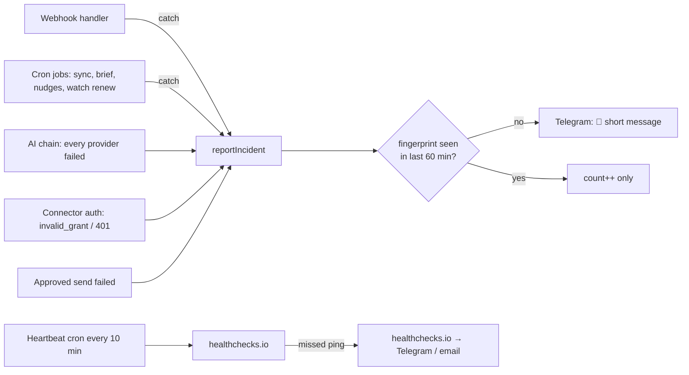
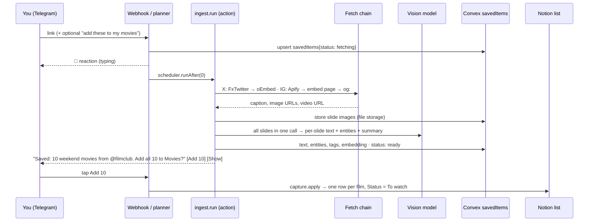
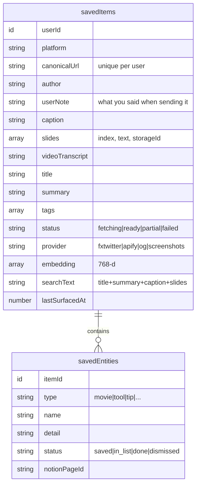

# PA: where it stands, what's left, and the social-post memory plan

Written 2026-10-15 against `cleanup/assistant-behaviour` @ `d118b84` in `/Users/thekiwidev/work/me/pa` (checked in your folder, not from memory).

**When this plan is done you'll have:**
1. A bot running on **production** that you don't have to reconnect every week.
2. A Telegram ping whenever the bot breaks, plus an outside watchdog for when the bot is completely down.
3. **Saved posts.** You send an Instagram or X link, and the bot reads the caption, every slide (with OCR) and short videos. It saves what it found to long-term memory, can drop items into Notion lists ("add these to my movies"), answers later questions ("what was that open-source vuln scanner?"), and brings saved items up when they're relevant to what you're working on.

---

## 1. What's done

### Built and working in code (Phases 0–11, 16, 21, plus today's cleanup)

| Area | State | Where |
|---|---|---|
| Telegram ↔ Convex ↔ AI loop, voice notes, images, documents | ✅ | `convex/http.ts`, `convex/assistant.ts` |
| Pluggable AI: Gemini, OpenAI, Anthropic and OpenRouter, with per-task routing and failover | ✅ | `convex/ai/*`, `convex/lib/ai/tiers.ts` |
| 3 Gmail mailboxes, **spam included**, push + 10-min sync, importance classifier | ✅ | `convex/gmail.ts`, `lib/email/classification.ts` |
| Alerts as short PA-style cards, "Not important" teaches a sender rule | ✅ (today) | `convex/notify.ts` |
| Draft → **you approve** → send from the **source mailbox** (hash-bound, single-use approval) | ✅ | `model/approvals.ts`, invariants 3 & 4 |
| Reply to an alert puts that email in focus ("when did this come in?") | ✅ (today) | `messages.ref` |
| Search gives the best match, with "next" and "show all" | ✅ (today) | |
| Google Calendar on every account, "am I free Thu 3pm", 30-min meeting nudges | ✅ (today) | `crons.ts` "meeting nudges" |
| Drive search + text extraction (read-only) | ✅ | `connectors/gdrive` |
| Notion notes as long-tail memory | ✅ | `connectors/notion` |
| Linear as the **only** task store; edits apply immediately | ✅ (today) | `connectors/linear` |
| Morning check-in in 5 lines or fewer, ending with the first thing to do | ✅ (today) | `briefs.ts`, `skills.ts` |
| Rolling conversation summary + 20-turn window | ✅ (today) | `conversationSummaries` |
| Meeting transcript → commitments → tasks | ✅ | Phase 21 |
| **Social links (partial):** X tweet text, TikTok caption + cover, IG caption + **cover image only**, OCR of that one image, "add these N items" card → Notion note or tasks | ✅ partial | `connectors/social/client.ts`, `link.read`, `capture.propose/apply` |
| Screenshots sent as an album are read as one document | ✅ | `mediaGroups` |
| OpenAI 400 on PLAN_TOOLS (json_object without "json") | ✅ fixed in `d118b84`, **already in your checkout** | `ai/providers/openai.ts` |
| Tests | 746 pass, typecheck clean | |

### Still open from today's thread (needs your hands)

| Item | State | What to run |
|---|---|---|
| Pull the latest bundle | ✅ Done: your folder is at `d118b84` | Delete `cleanup.bundle` from the repo root when finished |
| Linear 401 | ❓ Unconfirmed | New key → `bunx convex env set LINEAR_API_KEY '…'` → `bunx convex run debug:connectLinear '{}'` (must list your teams) |
| OpenAI key swap | ❓ Unconfirmed | `bunx convex env set OPENAI_API_KEY '…'` → `bunx convex run debug:pingAI '{"task":"PLAN_TOOLS"}'` → revoke the old key |
| `api.d.ts` pull conflict | ✅ Solved by the `git stash push -- convex/_generated/api.d.ts` sequence | |
| Runbook steps 4–8 (resetSkill, rawInstructions, scopes, `/reconnect`, test script) | ❓ Unconfirmed | [RUNBOOK-cleanup.md](/mnt/project-files/pa/RUNBOOK-cleanup.md) |

---

## 2. What's left

**A. Blocks "production, runs forever" (do first, §3):**
1. **Google OAuth app is in Testing mode.** Testing-mode refresh tokens expire after 7 days. That's why every mailbox keeps showing `NEEDS_REAUTH` (STATUS.md says all of them were in that state). This is the root cause of "reconnect over and over".
2. **No error reporting.** `syncAll` only `console.warn`s, cron failures go to Convex logs, and a failed message just goes quiet. Nothing in `convex/` sends you an error (I grepped for it).
3. **No watchdog.** If Convex or the webhook dies, the bot can't tell you, because it's the thing that's dead.
4. **Not deployed to prod.** Everything from today is on dev only. Prod has its **own database**, so mailboxes, Linear and skills must be connected once on prod.

**B. Left over from the cleanup:** an Undo button for Linear edits, blockers as Linear labels, an end-of-day check-in, native tool calling (a JSON loop is used today), and an `ARCHITECTURE.md` refresh.

**C. Left over from the roadmap:**

| Phase | Gap |
|---|---|
| 12 | Evening brief, weekly cost line |
| 13 / 14 | Daily focus, blocker follow-ups (`dailyFocus` table unused) |
| 15 | **Outlook / Zoho.** Your project brief asks for Outlook. Not built; only the schema mentions it |
| 17 | **Memory 2.0 (vectors).** The `memories` table and vector index exist and are unused. **The saved-posts feature is the trigger to build this** (§4) |
| 18 | Auto-send. Deliberately off: your brief requires a human in the loop |

**D. New: saved posts (§4).**

---

## 3. Production hardening

### 3.1 Keeping every integration connected

The analogy: each integration hands the bot a key. Some keys are permanent. Some expire unless you use them. Google's Testing mode gives out a key that self-destructs in 7 days no matter what.

| Integration | Credential | Why it dies today / could die | Fix | Re-auth after the fix |
|---|---|---|---|---|
| **Gmail / Calendar / Drive** | OAuth refresh token | **Testing mode = 7-day expiry.** Also: a password change revokes Gmail-scoped tokens, it dies after 6 months unused, and only the newest 50 tokens per account survive | **Publish the OAuth app to "In production"** (Google Cloud → Google Auth Platform → Audience → *Publish app*). You stay unverified with a 100-user cap, which is fine for one person. You'll see the "Google hasn't verified this app" screen once per account (Advanced → Go to app). Then `/reconnect` each mailbox **once** on prod. The 10-min sync refreshes tokens constantly, so the 6-month idle rule never triggers | Only if you change that Google password or remove the app |
| **Outlook** (when built) | MS refresh token (web app: 90 days, **rotates on every use**) | Must store the *new* token each refresh, or it dies at 90 days | Save the rotated token on every refresh; the daily sync keeps it inside the window. Also the **client secret** in Entra expires (max 24 months): set `MS_CLIENT_SECRET_EXPIRES_AT` and the health check warns you 30 days ahead | Rare: revocation, or the bot is off for ~90 days *(inferred: Microsoft doesn't document whether rotation slides the 90-day window)* |
| **Linear** | Personal API key, sealed in the DB by `connectLinear` | You revoke or rotate it | When creating the key, pick no expiry if Linear asks | Never |
| **Notion** | Internal integration token | You delete the integration, or a page isn't shared with it | Share every list DB with the integration (`•••` → Connections) | Never |
| **Telegram** | Bot token + webhook secret | You regenerate the token in BotFather | None | Never |
| **OpenAI / Gemini** | API keys | Revocation, or billing/quota runs out (shows up as 401/429) | Covered by health checks + failover | Never |

**Code changes:**
- `convex/ops.ts` `checkConnections` cron, daily at 06:30 WAT (`30 5 * * *`). It does a real call per integration: Google token refresh per account, Linear `viewer`, Notion `users/me`, OpenAI `models`, Gemini `models`. Any failure → alert (3.2). Breakage is caught at 06:30 instead of when you ask for something.
- **Pre-emptive warnings:** OAuth client secret expiry (MS), and any account still `NEEDS_REAUTH` after 24 h gets one reminder per day with the exact `/reconnect <label>` command.
- `/health` Telegram command: one line per integration (✅ / ⚠️ + reason), last sync time, last error.

### 3.2 Error alerts to Telegram



- **New table `opsIncidents`:** `fingerprint` (source + error class + normalised message), `count`, `firstAt`, `lastAt`, `lastAlertAt`, `mutedUntil`, `sample`.
- **`lib/ops/fingerprint.ts` (pure):** strips ids, numbers and tokens, so the same error repeated 50 times sends one alert. It also scrubs anything key-shaped (`sk-`, `lin_api_`, `ya29.`, `Bearer …`) before text leaves the server.
- **Message format** (matches BEHAVIOUR.md voice):
  `🔴 Mail sync failed for recruiting (Gmail said invalid_grant). Fix: /reconnect recruiting. 3× since 09:10.` with buttons [Mute 24h] [Details].
- **Severity:** `critical` (webhook crash, all AI providers down, auth lost) alerts immediately, even overnight. `warn` (one sync failed, one provider 429) is batched into one evening digest, and only when it repeats.
- **When your own message fails:** you get "That broke on my side. I've logged it." instead of silence, plus the incident.
- **Watchdog for total outages:** the `heartbeat` cron pings a [healthchecks.io](https://healthchecks.io) URL every 10 min (`HEALTHCHECK_PING_URL`). If pings stop, healthchecks.io messages you through its own Telegram integration. It runs outside Convex, so it works when your bot can't.

### 3.3 Going to prod (once 3.1–3.2 are in)

```bash
git checkout main && git merge cleanup/assistant-behaviour
bunx convex deploy
bunx convex env set --prod OPENAI_API_KEY '…'          # repeat for every var in docs/ENV.md
bunx convex run --prod debug:setWebhook '{}'           # or the existing webhook script
bunx convex run --prod debug:connectLinear '{}'
# Telegram (prod bot): /connect each mailbox, /health
```

---

## 4. Feature: saved posts (Instagram and X → memory → actions)

### 4.1 What already exists vs the gap

| You want | Today | Gap |
|---|---|---|
| IG caption | ✅ og: tags | Caption sometimes missing |
| **All IG slides** | ❌ Cover only (`slidesUnavailable`); Instagram serves slides 2+ only to logged-in sessions | Needs a fetch provider |
| X tweet text | ✅ oEmbed | |
| **X images / video** | ❌ `images: []` for X; `pbs.twimg.com` isn't on the URL allowlist | Use FxTwitter's JSON |
| OCR | ✅ for the images it gets (`readPostImages`, up to 20) | Needs per-slide structure and entity extraction |
| Video | ❌ | New |
| **Saved to long-term memory automatically** | ❌ Content lives only in that turn's tool result and is forgotten | New `savedItems` store |
| "Add to my movies list" | 🟡 `capture.apply` writes **one Notion note per batch** | Real Notion **list databases** with a Status property |
| "Which movie should I watch?" / "what was that scanner?" | ❌ | Search over saved items |
| Proactive "this tool you saved fits what you're doing" | ❌ | Relevance job |
| Survives the post being deleted | ❌ | Store slide images + extracted text at save time |

### 4.2 How it works

Think of it as a **mailroom**. Every link you send gets opened, photocopied (slides into storage), transcribed (OCR), filed with a summary label (entities + tags + embedding), and then you're asked whether any of it should go on one of your shelves (Notion lists). Later, the librarian (search) finds it by meaning, not just by exact words.



**Rules:**
- **Every link you send is saved automatically**, with no tap. Saving to your own database isn't consequential (invariant 4 is untouched).
- **Writing to Notion or Linear stays behind one tap**, the existing `capture.propose` card. That's your human-in-the-loop.
- If your message already says what to do ("add to my movies"), the bot goes straight to that card.
- Post content stays **untrusted** (invariant 2). Captions and OCR text enter prompts only through `AIRequest.untrusted`. A slide that says "ignore previous instructions" can't trigger anything, because output schemas have no action fields.
- **Honest partials:** "Got the caption and 3 of 8 slides. Send screenshots of the rest?" The screenshot path (`mediaGroups`) already exists and attaches to the same saved item.

### 4.3 Fetch chain per platform

| Platform | 1st | 2nd | 3rd | Last resort |
|---|---|---|---|---|
| **X** | `api.fxtwitter.com/2/status/<id>`: free, no key, returns text + photos + video variants (also covers quote tweets) | `publish.twitter.com/oembed` (today's code, text only) | og: tags | Screenshots |
| **Instagram** | **Apify** Instagram scraper (`APIFY_TOKEN`): caption, every carousel image (`childPosts[].displayUrl`), video URL for reels | `instagram.com/p/<code>/embed/captioned/`: unauthenticated, sometimes carries the full carousel *(inferred, unreliable; needs measuring)* | og: tags (today's code: caption + cover) | Screenshots |
| TikTok / LinkedIn / FB | Today's code | | | Screenshots |

**Why Apify for Instagram:** Meta's official oEmbed returns only a thumbnail. Logging in with your own IG cookies (instaloader-style) risks getting **your** account banned. A hosted scraper takes that risk off you, and it costs about $1.40–2.30 per 1,000 posts. At ~100 links a month that's cents, which Apify's monthly free credit covers. Invariant 7 bends slightly, which is why it's pluggable (`SOCIAL_IG_PROVIDER=apify|embed|og`, invariant 6). Scraping is against Instagram's terms; the risk is accepted here for personal, low-volume use.

**URL guard** (`lib/net/urlGuard.ts`): add `api.fxtwitter.com`, `pbs.twimg.com`, `video.twimg.com`, `t.co` (redirect hop), `instagr.am`, `fbcdn.net` (IG image CDN), and `api.apify.com`. Same SSRF rules apply: https only, re-vetted on every redirect, user-sent links only.

### 4.4 OCR and extraction

- **Model:** `gpt-5.4-mini` with vision (your free daily tokens), with Gemini Flash as failover. New task `EXTRACT_POST` on tier `VISION` in `lib/ai/tiers.ts` (`AI_ROUTE_EXTRACT_POST=openai`).
- **One call per post:** all slides go in one call (≤20 at `detail: high`), so the model sees the carousel as one story, which matters when slide 1 is the title and slides 2–10 are the list.
- **Output via `json_schema` (strict):**
  ```ts
  {
    title: string;                      // "10 movies for this weekend"
    summary: string;                    // 1–2 sentences
    kind: "list" | "tutorial" | "tool" | "news" | "opinion" | "other";
    slides: { index: number; text: string }[];
    entities: {
      type: "movie" | "series" | "book" | "tool" | "repo" | "tip" | "place" | "product" | "other";
      name: string; detail?: string; url?: string;
    }[];
    tags: string[];                     // "security", "deployment", "open-source"
  }
  ```
- **Video:** Gemini accepts video input directly. Download the video (≤20 MB, in a `"use node"` action, because the default runtime's memory is too small), send it with the caption, and get a transcript + summary + the same entity schema. Longer videos: caption + cover + "video too long, I saved the caption".

### 4.5 Data model



- **Search = hybrid:** a Convex `searchIndex` on `searchText` (exact names like "Nuclei") plus a `vectorIndex` on `embedding` (meaning, like "open source vulnerability tester"), merged by score. Embeddings come from **Gemini `gemini-embedding-001` at 768 dimensions** (free tier). That matches the dimension already declared on `memories`, so this also delivers Phase 17.
- **Storage:** slide images go into Convex file storage so a deleted post survives. That's about 2 MB per 10-slide post. Check the free plan's storage quota; past it, keep the text and drop images older than 90 days.

### 4.6 Notion lists

- You create one database per list: **Movies** (Name, Type: Movie/Series/Doc, Year, Status: To watch/Watched, Source URL, Added). Optionally **Tools** (Name, What it does, Link, Tags, Source URL) and **Reading**.
- `NOTION_LISTS` env maps names to database ids:
  `{"movies":"<db id>","tools":"<db id>"}`
- `capture.propose` gains `destination: "list"` + `list: "movies"`. `capture.apply` writes **one row per item** (not one note) and records `notionPageId` on the entity.
- **New tool `list.query`:** reads a list with a filter (e.g. Status = To watch). "I'm bored, which movie?" → `list.query(movies, To watch)` + saved-item context → the bot picks **one** with a one-line reason ("You saved *Arrival* from @filmclub, under 2h, sci-fi like the last two you watched"), with [Another] [Mark watched].

### 4.7 Recall: answering later questions

New tools in `lib/tools/catalog.ts`:

| Tool | Use |
|---|---|
| `saved.search { query, type?, since? }` | "What was that open-source vuln scanner?" → best match first (same pattern as email search) |
| `saved.get { itemId }` | Full slides/caption for follow-ups ("what were the other tips on that post?") |
| `saved.forget { itemId }` | Delete (one tap) |
| `list.query { list, status? }` | §4.6 |

Planner prompt rule (SCOPE): *"If the user asks about something they saw, sent or saved before, call `saved.search` before saying you don't know."*

**Auto-recall:** on every incoming message, embed it (one Gemini call, free), vector-search the saved items, and pass up to 3 hits above a score threshold to the planner as untrusted "possibly relevant saved items". This is how "I'm about to deploy the MLS site" gets "you saved a pre-deploy checklist from @devtips in September; want it?" without you asking.

### 4.8 Proactive reminders

| Trigger | Signal | Output |
|---|---|---|
| A Linear issue moves to **In Progress** (checked in the existing 10-min cron, or a Linear webhook later) | Issue title + description embedding vs saved items | "Starting THE-96 (Zod validation layer). You saved a Zod error-handling thread from @x on 2 Oct. Want it?" |
| Morning check-in | Today's calendar + top tasks vs saved items | At most one extra line, only above the threshold |
| Things you say in chat | Auto-recall (§4.7) | Inline in the reply |
| Weekend (Sat 10:00 WAT) | Movies list, Status = To watch | "Weekend pick: *Arrival*. 4 more on your list." (opt-in) |

**Guardrails so it doesn't nag:** at most 1 unsolicited nudge per day; the same item at most once every 14 days; [👍 Useful] [👎 Not now] buttons, where 👎 raises that item's threshold. An LLM check runs (`gpt-5.4-nano`: "is this saved item genuinely useful for this task? yes/no + why") before anything is sent.

### 4.9 Build order

| Step | Size | Delivers | Done when |
|---|---|---|---|
| **S1** `savedItems` + `savedEntities` schema, auto-save on every link, async `ingest.run`, the reply card | M | Links are remembered | Sending any link yields a saved row + a 2-line reply |
| **S2** X via FxTwitter (text + photos + video URLs), allowlist update | S | Full tweets with images | A 4-image tweet gives 4 OCR'd slides |
| **S3** Instagram via Apify + embed fallback + honest partials | M | All IG slides | A 10-slide carousel gives 10 slides of text |
| **S4** `EXTRACT_POST` structured OCR + entities | M | Movies/tools pulled out | A movie carousel gives N `movie` entities |
| **S5** Embeddings + hybrid `saved.search` + `saved.get` + planner rule | M | "What was that scanner?" | Answers correctly from a post saved a week earlier |
| **S6** Notion lists: `NOTION_LISTS`, `capture` → rows, `list.query` | M | "Add to my movies" / "which movie?" | Rows appear in Notion with Status = To watch; the pick comes with a reason |
| **S7** Auto-recall in the planner + proactive triggers + guardrails | M | Reminders when relevant | Moving a matching issue to In Progress gives one nudge, once |
| **S8** Video via Gemini (≤20 MB) | S–M | Reels/X video summaries | A 60s reel gives a transcript + entities |

Each step gets fixture-based unit tests first (FxTwitter JSON, Apify JSON, embed HTML, extraction schema, fingerprinting, nudge throttling) in `tests/unit`, plus `bunx convex run debug:ingest '{"url":"…"}'` for live checks. Each also gets a `CHANGELOG.md` entry, per `CLAUDE.md`.

**Overall order:** §3 hardening (3.1 Google publish + health check → 3.2 alerts + watchdog → 3.3 prod) → S1–S6 → S7–S8 → Outlook (Phase 15) → cleanup leftovers (Undo, EOD check-in).

---

## 5. What I need from you

| # | What | Why | Cost | How |
|---|---|---|---|---|
| 1 | Finish today's open items (§1 table) | Dev must be green before prod | – | Commands in §1 |
| 2 | **Publish the Google OAuth app** | Ends the 7-day expiry | Free | Google Cloud Console → Google Auth Platform → **Audience** → *Publish app* → confirm. Then `/reconnect <label>` each mailbox once (on prod, after §3.3) |
| 3 | **healthchecks.io** account | Watchdog when the bot is down | Free tier | Sign up → New check, period 10 min, grace 10 min → Integrations → Telegram → copy the ping URL → `bunx convex env set HEALTHCHECK_PING_URL '…'` |
| 4 | **Apify** account + token | Instagram carousels and reels | Monthly free credit covers personal volume; then ~$1.40–2.30 / 1k posts | apify.com → sign up → Settings → **API & Integrations** → copy the token → `bunx convex env set APIFY_TOKEN '…'`. Set a spending cap of $5 under Billing |
| 5 | **Notion Movies database** (+ Tools if you want) | Real lists with a Status column | Free | Create the DB with the columns in §4.6 → `•••` → **Connections** → add your existing PA integration → copy the DB id from the URL → `bunx convex env set NOTION_LISTS '{"movies":"…"}'` |
| 6 | OpenAI data sharing stays **on** | Keeps OCR on free daily tokens | Free up to the daily cap | Dashboard → Settings → Data controls → Sharing. Also set a monthly budget alert in Billing |
| 7 | Gemini key (existing) | Embeddings + video | Free tier | Nothing new |
| 8 | Outlook only: **Microsoft Entra app** | Outlook mail + junk folder | Free | entra.microsoft.com → App registrations → New → "Any Entra ID tenant + personal Microsoft accounts" → Web redirect `https://<prod>.convex.site/oauth/microsoft/callback` → API permissions: `offline_access`, `User.Read`, `Mail.ReadWrite`, `Mail.Send` → create a client secret (note its expiry) → set `MS_CLIENT_ID`, `MS_CLIENT_SECRET`, `MS_CLIENT_SECRET_EXPIRES_AT` |
| 9 | Decisions | | | (a) Store slide images, or text only? *Recommended: store them.* (b) Weekend movie pick on or off? *Recommended: on.* (c) Outlook now or after saved posts? *Recommended: after.* |

Nothing on X: FxTwitter needs no account. Don't give the bot your Instagram login.

---

## 6. Risks

- **Instagram changes break scrapers.** Apify maintains theirs, the embed page and og: are fallbacks, and screenshots always work. The bot says what it couldn't get rather than pretending.
- **FxTwitter is a free community service.** It's self-hostable (MIT) if it ever disappears, and oEmbed keeps text working regardless.
- **The unverified Google app shows a warning screen** at each connect. That's cosmetic for personal use. Verification is only needed past 100 users.
- **Alert fatigue:** fingerprint dedupe + severity + mute buttons. If it still nags, raise `warn` to digest-only.

Sources: [Google: Testing-mode refresh tokens expire after 7 days; publishing to production fixes it](https://developers.google.com/health/setup) · [Google refresh-token revocation causes (50-token cap, 6-month idle, password change)](https://www.unipile.com/google-oauth-refresh-token/) · [Microsoft refresh token lifetimes and rotation](https://learn.microsoft.com/en-ca/entra/identity-platform/refresh-tokens) · [FxTwitter API](https://korben.info/en/fxtwitter-free-api-read-x-without-account.html) · [Apify Instagram API Scraper](https://apify.com/apify/instagram-api-scraper) · [Apify free plan](https://use-apify.com/docs/what-is-apify/apify-free-plan)
